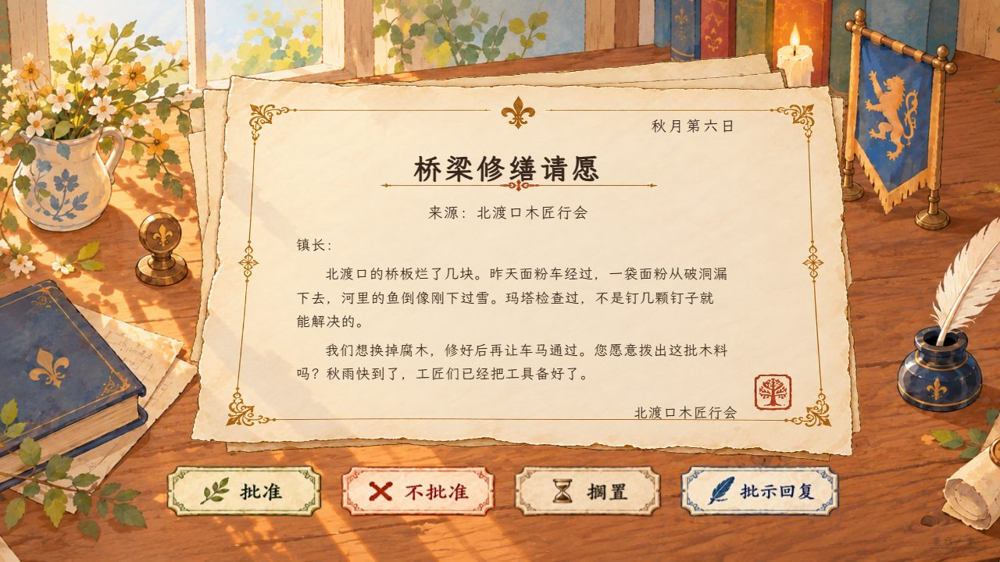

# Dear Mayor

A quiet, illustrated game about reading a town's letters and deciding how to respond. Your choices become part of its history; some correspondents return later with consequences. The interface and letters are in Simplified Chinese.

[Play online](https://seiya058904.github.io/Dear-Mayor/) · [How to play](#how-to-play) · [Run locally](#run-locally)

*Original illustration based on the letter and decision system, not a screenshot.*

## Features

- **Read authored correspondence:** requests, characters, and outcomes are bundled with the game rather than generated by an online AI service.
- **Choose a response:** approve, reject, leave a letter unanswered, or choose one of three letter-specific written instructions.
- **See consequences later:** some follow-up letters reflect earlier choices and the relationships behind them.
- **Keep the focus on the letter:** the game presents no resource meter, moral score, quest log, or immediate consequence dashboard.
- **Continue locally:** progress is saved in the browser, with recovery handling for unreadable saves.
- **Read on different screens:** the desktop writing desk adapts to a flowing paper layout on narrow viewports.



*Actual Chromium capture of the local development version.*

## How to play

1. Read the sender's request and decide what you know—and what remains uncertain.
2. Approve or reject, leave the letter unanswered, or open the instruction note and choose a response.
3. Continue through the correspondence. Later letters can reflect earlier decisions.

**Set aside means silence:** it sends no reply and does not create a postponed item in an inbox. A formal rejection is a separate decision. Opening and closing the instruction note does not commit a choice.

## Progress and offline use

Progress belongs to the current browser and site origin. The hosted game, localhost, and different browser profiles do not share it automatically; clearing site data may erase it. Restarting the season requires confirmation. Editing the same run in multiple tabs is not supported.

If an unreadable save cannot be backed up, the original text remains protected until you explicitly discard it; the recovery dialog offers an export. Existing letters retain their wording and options through updates. Production offline continuation requires an initial successful load and complete resource caching.

## Run locally

**Prerequisites:** Node.js 24 and npm.

```sh
npm ci
npm run dev
```

Open `http://127.0.0.1:5173/`. To check the engine and create a production build:

```sh
npm run check
npm run build
npm run preview
```

The app uses React, TypeScript, and Vite. Browser interaction and offline checks use the lockfile's Playwright version:

```sh
npx playwright install chromium
npm run test:e2e
```

The game has no account system, application backend, runtime CDN, or live AI calls. A successful source build alone does not prove the hosted site has been updated.

## Project map

- [`src/content/`](src/content/) — letters, recurring characters, story branches, and outcomes.
- [`src/game/`](src/game/) — scheduling, decisions, saves, and validation.
- [`src/components/`](src/components/) — the desk, letter interface, and instruction note.
- [`public/art/`](public/art/), [`public/fonts/`](public/fonts/), and [`tests/`](tests/) — artwork, bundled typeface, and regression coverage.

See [content and save contracts](docs/CONTENT.md), [design decisions](docs/DECISIONS.md), [asset provenance](docs/ASSETS.md), and [test evidence](docs/QA.md). Historical reports apply to the versions they describe.

## Assets and usage

The illustrated interface uses supplied artwork and derivative paper assets. The bundled [LXGW WenKai Lite](https://github.com/lxgw/LxgwWenKai-Lite) typeface is distributed under the included [SIL Open Font License](public/fonts/OFL.txt).

The repository does not declare a blanket license for its code, writing, or visual assets. Public access alone does not grant permission to redistribute or relicense them; see the [asset documentation](docs/ASSETS.md).
