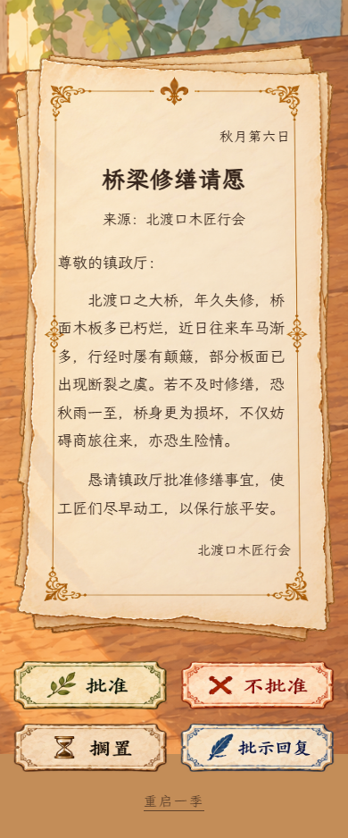

<h1 align="center">✉️ DEAR MAYOR</h1>

<p align="center">
  <strong>Every letter asks for an answer. Every answer leaves a trace.</strong>
</p>

<p align="center">
  《小镇，请批示》——在一张洒满阳光的书桌前，读信、批示，然后等待小镇寄来后续。
</p>

<p align="center">
  <a href="https://seiya058904.github.io/Dear-Mayor/"><strong>▶ 在线游玩</strong></a>
  &nbsp;·&nbsp;
  <a href="#how-it-works">✒️ 玩法介绍</a>
  &nbsp;·&nbsp;
  <a href="#game-preview">🖼️ 游戏画面</a>
  &nbsp;·&nbsp;
  <a href="#quick-start">⚙️ 本地运行</a>
</p>

<p align="center">
  <sub>116 封不同来函 &nbsp;·&nbsp; 12 条故事线 &nbsp;·&nbsp; 一局 20 个游戏日 &nbsp;·&nbsp; 无账号、无计分</sub>
</p>

<p align="center">
  <a href="https://github.com/seiya058904/Dear-Mayor/actions/workflows/pages.yml">
    
  </a>
</p>

<p align="center">
  
</p>

---

> **你是镇长，但这不是一款追求完美数值的经营游戏。**
>
> 每天送到桌上的，是修桥的申请、钟匠的抱怨、邻里的误会，以及看似不重要的小事。你只能根据手头的信件作出判断。答案不会立刻出现；过几天，写信的人会再来告诉你发生了什么。

<a id="how-it-works"></a>
## ✒️ One Letter at a Time · 一封信，一次决定

<p align="center"><code>READ THE LETTER → MAKE A DECISION → TURN THE DAY → SEE WHAT FOLLOWS</code></p>

1. **阅读来函。** 留意发信人、诉求和那些没有说出口的细节。
2. **作出处理。** 直接批准、正式驳回、搁置不复，或展开便笺选择一条具体批示。
3. **继续处理下一封。** 每一天有新的事务；系统会记住你的决定。
4. **收到后续。** 同一个人可能带着新的问题回来，而此前的处理方式会改变来信的内容。

四种处理并非换皮按钮：

| 处理方式 | 在游戏中意味着什么 |
| :--- | :--- |
| **批准** | 同意来函中的请求 |
| **不批准** | 明确拒绝；对方知道你的态度 |
| **搁置** | 不回复、不办理；**不是**将原信延后排队 |
| **批示** | 从三条针对当前信件的具体方案中选择其一 |

没有资源面板、任务清单、道德分数或即时公布的正确答案。这里最重要的，是**一次决定如何变成另一封信**。

## ✨ What's Inside · 小镇里有什么

<table>
  <tr>
    <td width="50%" valign="top">
      <h3>📜 116 封不同文书</h3>
      <p>12 条故事线与 32 封独立日常来函；人物、请求与结果由手工编写，不依赖在线生成。</p>
    </td>
    <td width="50%" valign="top">
      <h3>🧩 有回响的故事</h3>
      <p>每条主线按起始、决策、后续、收尾四个阶段推进，彼此冲突的结果不会在同一局里同时出现。</p>
    </td>
  </tr>
  <tr>
    <td width="50%" valign="top">
      <h3>🕰️ 一段完整任期</h3>
      <p>一局处理 80 封不重复文书，跨越 20 个游戏日。主体结束后仍有带处理记忆的循环日常来函。</p>
    </td>
    <td width="50%" valign="top">
      <h3>👥 会再次来信的人</h3>
      <p>18 个重复出现的人物或机构署名，加上其他镇民，让前一次会面成为下一次判断的背景。</p>
    </td>
  </tr>
  <tr>
    <td width="50%" valign="top">
      <h3>🎨 手绘绘本书桌</h3>
      <p>暖色木桌、旧纸、墨迹与印章构成主要界面。文书文字是真实可排版文本，而不是写死在整张图片里。</p>
    </td>
    <td width="50%" valign="top">
      <h3>💾 自动保存与离线继续</h3>
      <p>处理后自动保存；生产版在首次完成资源缓存后可离线继续。没有登录、云存档或在线 AI。</p>
    </td>
  </tr>
</table>

<a id="game-preview"></a>
## 🖼️ A Closer Look · 游戏画面

<table>
  <tr>
    <td width="65%" align="center" valign="top">
      
      <br />
      <sub>提笔批示 · 按当前来函选择具体方案</sub>
    </td>
    <td width="35%" align="center" valign="top">
      
      <br />
      <sub>竖屏阅读 · 文书自然换行与双列决定卡片</sub>
    </td>
  </tr>
</table>

原始参考以 1672 × 941 桌面画面为基线；手机布局是为阅读与触摸操作另外设计的适配版本，并非参考图的逐像素复制。

<a id="quick-start"></a>
## 🚀 Play Online or Run Locally

### 🌐 在线游玩

**[打开 Dear Mayor →](https://seiya058904.github.io/Dear-Mayor/)**

游戏通过 GitHub Pages 发布，无须安装或注册。页面部署状态可在上方的 GitHub Actions 徽章中查看。

### 💻 本地运行

需要 **Node.js 24** 和 npm。克隆仓库后，在项目根目录执行：

```bash
npm ci
npm run dev
```

在浏览器中打开 **http://127.0.0.1:5173/**。

<details>
<summary><strong>开发验证与生产构建</strong></summary>

```bash
npm run check          # TypeScript 检查 + 引擎回归测试
npm run build          # 生成 dist/，包括生产离线缓存
npx playwright install chromium
npm run test:e2e       # Chromium 浏览器测试
npm run preview        # 预览生产构建
```

技术栈为 **React 19 · TypeScript · Vite 8**。文书、人物、调度与存档都在仓库内运行；没有服务端游戏逻辑、分析 SDK 或运行时外部字体依赖。

</details>

## 💾 Progress Belongs to Your Browser · 存档说明

- 进度仅保存在**当前浏览器与当前站点**。GitHub Pages、本地开发站点和不同浏览器之间不会自动同步。
- 清理网站数据可能删除进度；当前没有云同步、跨设备迁移或多标签页并发编辑。
- 右下角的「重启一季」会在确认后替换本局存档；取消操作不会重开。
- 离线游玩以**生产版首次联网并完整缓存**为前提；开发服务器不会启用同样的离线缓存。

## 🛠️ For Developers · 项目结构

```text
src/content/      文书、人物口吻、故事分支与后续
src/game/         调度、决策、存档与校验
src/components/   书桌交互、来函、批示与按钮
public/art/       书桌与纸张美术资源
public/fonts/     本地字体与许可证
tests/            引擎、存档、交互及离线测试
docs/             内容规范、设计取舍、素材来源与验收
```

继续开发或修改文书前，请先阅读：

- [内容与存档约定](docs/CONTENT.md) · [设计取舍](docs/DECISIONS.md) · [协作规则](AGENTS.md)
- [美术素材与来源](docs/ASSETS.md) · [测试及发布验收记录](docs/QA.md)

推送至 `main` 会触发检查与 GitHub Pages 部署；自动化状态请以 [工作流记录](https://github.com/seiya058904/Dear-Mayor/actions/workflows/pages.yml) 为准。

## 📖 Art, Type & Usage · 素材与使用边界

界面使用项目内附带的美术素材及衍生纸面。中文字体采用 [LXGW WenKai Lite](https://github.com/lxgw/LxgwWenKai-Lite)，字体许可证见 [SIL OFL](public/fonts/OFL.txt)。

本仓库公开可浏览，但**未附带统一的代码或素材再许可声明**；请勿仅因源码公开就推定所有插画、文本及其他资源可以自由再分发。更详细的来源与处理方式见 [ASSETS.md](docs/ASSETS.md)。

---

<p align="center">
  <sub>THE TOWN DOESN'T SEND YOU A SCORE. IT SENDS ANOTHER LETTER.</sub><br />
  <sub>《小镇，请批示》 · 一张书桌，一座小镇，无数等待回信的小事。</sub>
</p>
